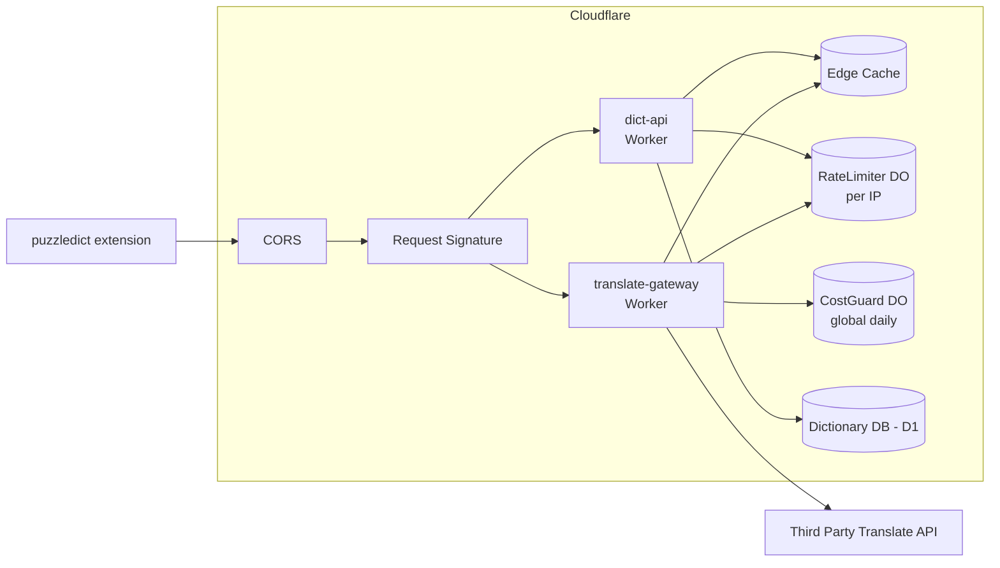

# web-services

Backend services for [`puzzledict`](https://github.com/zhongyangxun/puzzledict), running on Cloudflare Workers.

## Packages

| Package                                           | Description                                                  |
| ------------------------------------------------- | ------------------------------------------------------------ |
| [dict-api](./packages/dict-api)                   | Remote dictionary API for puzzledict.                        |
| [translate-gateway](./packages/translate-gateway) | Remote translation API for puzzledict.                       |
| [shared](./packages/shared)                       | Shared code for this monorepo, a build-time library.         |
| [beacon](./packages/beacon)                       | Placeholder package for future beacon-related functionality. |

## Architecture

`dict-api` and `translate-gateway` are both Workers for puzzledict.
`shared` includes utilities, like: CORS, Signature, Edge Cache, Rate Limit, Cost Guard, etc.

### Request Paths

- **dict-api** (`POST /lookup`)
  CORS -> Signature -> Edge Cache Check -> Rate Limit -> Dictionary DB (D1) -> Edge Cache Write
  - Edge Cache Check: If a hit occurs, skip subsequent steps
  - Dictionary DB (D1) data source: [ECDICT](https://github.com/skywind3000/ECDICT)

- **translate-gateway** (`POST /translate`)
  CORS -> Signature -> Edge Cache Check -> Rate Limit -> Quota Check -> Third Party Translate API -> Edge Cache Write
  - Edge Cache Check: If a hit occurs, skip subsequent steps
  - Third Party Translate API: [Youdao](https://fanyi.youdao.com/openapi/)

## Design Highlights

- Cache hits do not count toward rate limits or daily quotas (quotas are only for `translate-gateway`).
- Smart Placement runs `translate-gateway` near the third party translate API.
- Rate limit and daily quota checks run in parallel on `translate-gateway` to reduce latency.
- Daily quota is rolled back when the third party translate API call fails.

## Tech Stack

TypeScript · Hono · Wrangler · Turborepo · pnpm · D1 · Durable Objects · Cache API

## Engineering

CI (format · lint · build dry-run) · commitlint · lint-staged · ggshield / gitleaks
